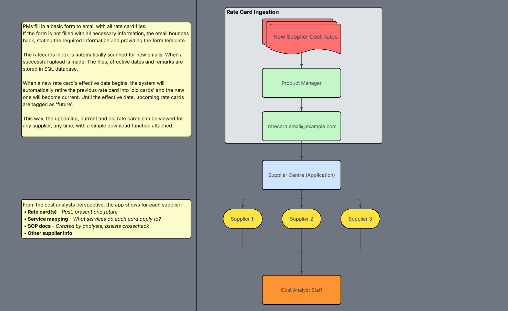

# supplier-centre
  > [!NOTE]
  > This repo tracks the design, decisions and progress of Supplier Centre. No code is included in this repo.

An E2E pipeline for a logistics firm that ingests suppliers’ cost rate cards, organises them, and displays them to staff alongside other key supplier information in one central application.

## Overview

Before this system, rate cards were scattered between product managers (PMs) and whichever analyst was handling a given supplier. With more than 50 suppliers and most issuing 2–12 rate cards a year, keeping track of everything was impossible. Rate cards were often lost or mixed up, especially ones no longer active. As a result; taking over a supplier, cross-checking or recalculating old parcels, and preparing P&L reports were slow and often inaccurate.

Rate card management was the main concern, but the same lack of visibility applied to SOP documents and other key supplier details. Supplier Centre addresses all of this by giving analysts one central application that holds everything they need, so they can focus on their actual work instead of treasure hunting.

## How it works

  

### Email ingestion

- The rate card inbox is an alias, connected to my main inbox which filters all rate card related emails to a dedicated folder. The folder is read through Microsoft's Graph API every 5 seconds.
- Supplier names on the form are matched to a supplier list, so typos and variants still file under the right supplier.
- Each file is checked to make sure it opens. Password-protected, scanned or broken files are rejected.
- Accepted new cards go live instantly

### Storage Setup

- Everything sits in its own section of the existing Cost Database (MySQL), separate from the supplier data already there.
- Rate card files are stored inside the database itself, not on a shared drive, along with any extra files sent with them (contracts, cover letters).
- Every action on a card is logged: who sent, confirmed, edited or downloaded it, and when.
- Nothing is ever deleted. Wrong cards are withdrawn and can be restored.
- Staff get read-only access. Only the automation or myself can add or change cards.
